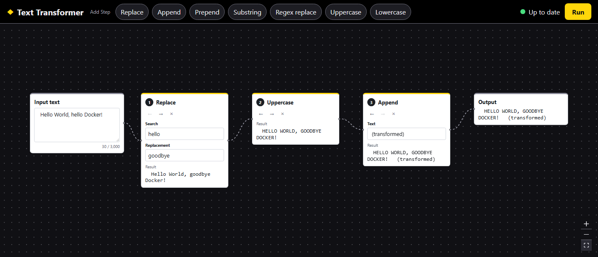

# Text Transformer

## What it is

A no-code tool for changing text in a repeatable way. You build a **Chain** of **Steps** on a node canvas (Input text → Step → … → Output), choosing from the **Transformations** the backend offers: Replace, Append, Prepend, Substring, Regex replace, Uppercase, Lowercase, Reverse, Trim whitespace, Mask, Base64 encode and Base64 decode. Each Step shows its own result, so you can see what every change did. Press Run and the backend runs the Chain; if anything is wrong, it tells you everything that is wrong at once and marks the Steps responsible. Your work survives a page reload.



It is a Vue 3 + TypeScript single-page app, served by a Spring Boot API that calls a Spring-free Java library (`core`) in-process. The words used throughout (Transformation, Field, Step, Chain, Saved session, …) are defined in [`GLOSSARY.md`](GLOSSARY.md).

```text
core/       Java 25 library: Transformations, Field rules, ChainRunner (no Spring, no Jackson)
app/        Spring Boot: GET /api/transformations, POST /api/chain/run, serves the built frontend
frontend/   Vue 3 + Vite + Vue Flow canvas, built into the app jar
contract/   Example JSON shared by the backend tests and the frontend tests
```

## Highlights

### A new Transformation is backend-only

The frontend draws its toolbar and every Field from `GET /api/transformations`, and the validation rules come from the same Field declarations. So adding a Transformation touches `core` and nothing else. The three steps, checked by adding a throwaway `Repeat` Transformation, seeing it appear in the toolbar and run on the canvas with no frontend change, then removing it again:

1. **Write one class** in `core/src/main/java/io/github/khalifa1997/texttransformer/core/`:

   ```java
   final class Repeat implements Transformation {
       public String id()          { return "repeat"; }
       public String label()       { return "Repeat"; }
       public String description() { return "Repeats the text a number of times."; }

       public List<FieldSpec> fields() {
           // name, label, required, default, min, max
           return List.of(FieldSpec.integer("times", "Times", true, 2, 1, 10));
       }

       public String apply(String input, FieldValues values) {
           return input.repeat(values.integer("times"));
       }
   }
   ```

2. **Add one line** to the explicit list in `BuiltInTransformations.all()`: `new Repeat()`.
3. **Rebuild** (`./mvnw package -DskipTests`) and run it. "Repeat" is now a button in the toolbar, its **Times** Field shows as a number input starting at 2, `POST /api/chain/run` with `times: 3` turns `ha` into `hahaha`, and `times: 11` comes back as the Step error "Times must be 10 or less." on that Step's Field.

Nothing in `frontend/` changed. The frontend skips a Transformation whose Field type it doesn't know (with a console warning), so a newer backend can't break an older frontend.

### All errors arrive at once

The backend validates every Step up front and reports **every** problem in one `422` response, not just the first. Each error carries the Step id, the Field, a kebab-case `code` and a plain-English message that uses the Field's label:

```json
{
  "status": 422,
  "title": "Chain could not run",
  "detail": "2 problems stop the Chain from running.",
  "errors": [
    { "stepId": "1111…", "field": "search", "code": "required", "detail": "Search is required." },
    { "stepId": "2222…", "field": "search", "code": "required", "detail": "Search is required." }
  ]
}
```

The canvas rings every failing Step in red, shows each message under its Field (linked with `aria-invalid` and `aria-describedby`) and announces the count. Problems with the Input text or the Chain as a whole (an **Input error**) show in the Input node. A server that can't be reached is a different thing, a **Run failure**, and never marks a Step. The full catalogue of 13 errors is on [#7](https://github.com/Khalifa1997/KNIME_Task/issues/7); the shared examples are in [`contract/`](contract/).

### Accessibility

Accessibility is a rule of the project (`AGENTS.md`), and `@axe-core/playwright` fails the end-to-end run on any WCAG 2.2 A/AA violation (the always-flowing edges, WCAG 2.2.2, are the one accepted gap; see below).

- Everything works by keyboard: Tab order follows Chain order, Delete removes a Step, the ←/→ (↑/↓ on phones) buttons reorder, and Ctrl/⌘+Enter runs the Chain even from inside a Field. Arrow keys on a node move only its position.
- Moves, swaps and deletes are announced through our own polite live region; run status uses `role="status"`; load failures use `role="alert"`.
- Colours meet AA contrast, and focus has a two-tone ring on dark surfaces and a thicker border on Fields in cards.
- Targets grow to 44px on coarse pointers, the layout is a single column below 800px, and `prefers-reduced-motion` stops the flowing edges and the run animation.

### The self-reconciling Saved session

The **Saved session** (Input text, Chain with Field values, and canvas layout; never results or errors) is kept in session storage and restored after a reload. It never loses work silently, even if the backend has changed since it was saved. After the metadata loads, it is reconciled against what the backend offers now:

- A Field that is still there with the same type keeps its value. An added Field takes its default. A removed Field is dropped (a rename is a removal plus an addition). A notice lists these adjustments.
- A value that no longer fits the rules is **kept as it is**, and a removed Choice shows as unavailable. The Step errors are not made up on restore, and a Saved session over the current limits is restored in full: nothing is truncated or deleted.
- If a Transformation is gone, a Field changed type, or the snapshot is malformed or from an unknown version, restoring is **blocked** with a named reason. The snapshot stays untouched, and you choose Retry or a confirmed "Discard saved session and start fresh".
- Across the 800px breakpoint the Chain is restored but laid out afresh for the new layout. A reload never runs the Chain.

See [#11](https://github.com/Khalifa1997/KNIME_Task/issues/11), [#33](https://github.com/Khalifa1997/KNIME_Task/issues/33) and [#34](https://github.com/Khalifa1997/KNIME_Task/issues/34).

### The Vue Flow fix

In `@xyflow/vue` `2.0.0-next.18` a touch drag doesn't move a node (a mouse drag does), which would have made the canvas unusable on phones and tablets. A minimal repro confirmed it (0px moved unpatched, 180px patched). The app ships a [`patch-package`](https://github.com/ds300/patch-package) patch ([`frontend/patches/`](frontend/patches/)) that makes three `NodeWrapper` getters `computed`, so d3-drag isn't re-bound mid-gesture. `@xyflow/vue` is pinned to exactly that version, `postinstall` runs `patch-package --error-on-fail` so a patch that stops applying fails loudly at `npm ci`, and an end-to-end test (`touch-drag.spec.ts`) guards it. Details: [#15](https://github.com/Khalifa1997/KNIME_Task/issues/15), [#31](https://github.com/Khalifa1997/KNIME_Task/issues/31).

## Run it

There are three ways, in order of how little they need. All of them serve the app on <http://localhost:8080>.

### 1. JDK 25 only

Install JDK 25 (for example Temurin 25 from [adoptium.net](https://adoptium.net)). Node and npm are downloaded into `frontend/target/` by the build, so you don't need them. A wrong Java version fails fast with "Java 25 is required".

```bash
./mvnw package                 # builds, then runs the Java tests, lint, type-check and Vitest
java -jar app/target/app.jar
```

**Quick start:** `./mvnw package -DskipTests` builds the same jar faster, but `-DskipTests` also skips lint, type-check and Vitest (they are bound to the test phase). Use it for a first look, not for checking your work.

### 2. GitHub Codespaces (or VS Code "Reopen in Container")

Open the repository in a Codespace, or run **Dev Containers: Reopen in Container** in VS Code. [`.devcontainer/devcontainer.json`](.devcontainer/devcontainer.json) installs Java 25 and Node 24, runs `npm ci` in `frontend/`, and forwards ports 8080 and 5173. Then follow path 1 above.

### 3. Docker

```bash
docker compose up --build      # first build runs ./mvnw package inside the image (several minutes)
```

The multi-stage [`Dockerfile`](Dockerfile) builds with `eclipse-temurin:25-jdk` and `./mvnw package`, and runs the jar on `eclipse-temurin:25-jre`. Stop it with `docker compose down`.

### Deploying (free tiers)

- **Backend on Render:** New → Blueprint, pick this repo. [`render.yaml`](render.yaml) builds the same `Dockerfile` as a free web service; the app listens on Render's `PORT`. Free services sleep when idle, so the first request after a while takes 30–60 s.
- **Frontend on Netlify:** Add new site → Import from Git. [`netlify.toml`](netlify.toml) builds `frontend/` and proxies `/api/*` to the Render service, so there is still no CORS. Set its `to` URL to your Render service's URL.

### Dev loop

Two processes, with Vite proxying `/api` to Spring Boot (so there is no CORS anywhere):

```bash
./mvnw -pl app -am spring-boot:run -DskipTests    # backend on :8080 (builds core and the frontend first)
cd frontend && npm ci && npm run dev              # Vite with hot reload on :5173
```

Open <http://localhost:5173>. If the backend runs on another port, set `API_PROXY_TARGET`, for example `API_PROXY_TARGET=http://localhost:9090 npm run dev`.

### The Content check (optional)

The Content check sends the Input text to OpenAI's Moderation API before a run. It needs an API key on the server, read from `OPENAI_API_KEY`; the key never reaches the browser. Without it, the OpenAI badge on the first line of the Chain shows as not available.

```bash
OPENAI_API_KEY=sk-... java -jar app/target/app.jar                       # or with spring-boot:run
OPENAI_API_KEY=sk-... docker compose up --build                          # compose passes it through
```

On Render, set `OPENAI_API_KEY` under the service's **Environment**; [`render.yaml`](render.yaml) declares it without a value, so it is never committed.

## Test it

```bash
./mvnw package                                   # Java tests (JUnit + MockMvc), lint, type-check, Vitest
cd frontend
npx playwright install chromium                  # once
npm run test:e2e                                 # end-to-end against the real jar
```

- `./mvnw package` runs, in order: the `core` tests (one per Transformation example and per error), the `app` tests (both endpoints compared strictly against the [`contract/`](contract/) JSON), then ESLint + Stylelint, `vue-tsc` and Vitest.
- `npm run test:e2e` runs Playwright on Chromium (desktop and Pixel 7 phone emulation) against `app/target/app.jar`, which it starts itself on port 8181 (set `E2E_PORT` to change it), so build the jar first. It covers the four success criteria, touch drag, Shift+drag swap, reordering, Run failures and Retry, and axe scans.
- **Investigating a suspected performance regression** (dragging, typing in a Field or a long Chain feeling slow): profile the app served from the jar in Chrome with Chrome DevTools (the Performance panel or the Chrome DevTools MCP server). Record a trace, read its insights (long tasks, layout and style cost, INP), check the timing of `POST /api/chain/run`, and compare traces before and after a fix. It is an investigation tool, not a gate: no performance budget runs in the build.

## How I built it

The planning came first: I used an AI agent to grill the open questions into 18 decision tickets under one map, [Text Transformer MVP: build-ready plan (#1)](https://github.com/Khalifa1997/KNIME_Task/issues/1), turned that into the [spec (#21)](https://github.com/Khalifa1997/KNIME_Task/issues/21), then built it as vertical slices ([#22](https://github.com/Khalifa1997/KNIME_Task/issues/22) to [#36](https://github.com/Khalifa1997/KNIME_Task/issues/36)), one PR each. Five decisions shaped it most:

1. **A Spring-free `core` library behind a thin Spring Boot `app`** ([#2](https://github.com/Khalifa1997/KNIME_Task/issues/2), [#8](https://github.com/Khalifa1997/KNIME_Task/issues/8)). `core` has no Spring and no Jackson (an Enforcer rule guards it), and owns every Field rule. *Trade-off:* a little mapping code in `app` instead of annotations on the domain.
2. **The backend is the source of truth and the frontend is generic** ([#6](https://github.com/Khalifa1997/KNIME_Task/issues/6), [#7](https://github.com/Khalifa1997/KNIME_Task/issues/7)). Metadata and validation come from the same Field declarations, so a new Transformation needs no frontend change. *Trade-off:* the UI can't show a rule before a Run, so `required` and `min` are only gentle native hints.
3. **All errors in one `422`, with a stable `code`** ([#7](https://github.com/Khalifa1997/KNIME_Task/issues/7), [#25](https://github.com/Khalifa1997/KNIME_Task/issues/25)). *Trade-off:* a failed Run returns no partial results, and messages are English-only (the `code` keeps translation possible).
4. **One jar, one port, two build tools** ([#14](https://github.com/Khalifa1997/KNIME_Task/issues/14)). A Maven `frontend` module builds the Vue app into the jar, so `./mvnw package` and `java -jar` is the whole story. *Trade-off:* a slower first build, since Maven downloads Node and runs `npm ci`.
5. **Vue Flow canvas with our own state and a patch** ([#4](https://github.com/Khalifa1997/KNIME_Task/issues/4), [#16](https://github.com/Khalifa1997/KNIME_Task/issues/16), [#15](https://github.com/Khalifa1997/KNIME_Task/issues/15)). `App.vue` owns plain reactive state, and Vue Flow nodes are built from it. *Trade-off:* a pre-release canvas library pinned exactly, plus a patch to carry (see the limitations below).

Other trade-offs I accepted on purpose: ESLint alone (no oxlint) so Vue templates and accessibility rules are linted ([#13](https://github.com/Khalifa1997/KNIME_Task/issues/13)); a Saved session that keeps invalid values instead of silently fixing them ([#11](https://github.com/Khalifa1997/KNIME_Task/issues/11)); and no CI, with end-to-end tests run by hand ([#18](https://github.com/Khalifa1997/KNIME_Task/issues/18)).

Where to read more:

- **The map:** [#1 Text Transformer MVP: build-ready plan](https://github.com/Khalifa1997/KNIME_Task/issues/1), the index of every decision. The [spec (#21)](https://github.com/Khalifa1997/KNIME_Task/issues/21) summarises it as user stories and implementation decisions.
- **The tickets:** decisions [#2](https://github.com/Khalifa1997/KNIME_Task/issues/2) to [#19](https://github.com/Khalifa1997/KNIME_Task/issues/19), implementation [#22](https://github.com/Khalifa1997/KNIME_Task/issues/22) to [#36](https://github.com/Khalifa1997/KNIME_Task/issues/36) (all [issues](https://github.com/Khalifa1997/KNIME_Task/issues?q=is%3Aissue)).
- **Branches:** [`prototype`](https://github.com/Khalifa1997/KNIME_Task/tree/prototype) holds the throwaway prototypes (`prototypes/canvas-core-flow`, `prototypes/vue-flow-touch-repro`) and is never merged; [`research`](https://github.com/Khalifa1997/KNIME_Task/tree/research) holds the research notes (`docs/research/`).
- **Vocabulary:** [`GLOSSARY.md`](GLOSSARY.md).

### How AI was used

This project was built with AI, and I want that to be plain. I worked with the Pi coding agent using Claude models, for research, planning (grilling the decisions on the map), the spec, writing the code and tests, and reviewing PRs. The decisions and the merges were mine; the agent did most of the typing. Nothing here is hidden:

- [`PROMPTS.md`](PROMPTS.md): every prompt I sent to the agent, in order, logged automatically by a Pi extension in [`.pi/extensions/`](.pi/extensions/prompt-log.ts).
- **The map** ([#1](https://github.com/Khalifa1997/KNIME_Task/issues/1)) and its tickets: the decisions, with the reasoning behind each.
- [`ai-logs/`](ai-logs/): the full agent transcripts. They land there only after I've reviewed them, so [`ai-logs/README.md`](ai-logs/README.md) says what's there so far.

## Known limitations and next steps

- **Vue Flow patch.** Touch dragging relies on our patch to `@xyflow/vue` `2.0.0-next.18`. The bug has not been reported upstream yet: [Report the Vue Flow touch-drag bug upstream (deferred)](https://github.com/Khalifa1997/KNIME_Task/issues/20) tracks filing it (the draft is `prototypes/vue-flow-touch-repro/UPSTREAM-ISSUE.md` on the `prototype` branch). On every upgrade of the library, re-run the touch-drag test without the patch and delete the patch if it passes.
- **WCAG 2.2.2.** The dashed edges always flow, so there is no way to pause them unless the OS asks for reduced motion. This is an accepted gap ([#12](https://github.com/Khalifa1997/KNIME_Task/issues/12)).
- **Session storage only.** The Saved session lives in `sessionStorage`: it survives a reload but not a closed tab, and is not shared between tabs or devices. There are no accounts or server-side saving, and old schema versions are not migrated (they block the restore instead).
- **Only twelve Transformations.** The registry makes more cheap to add (see the walkthrough above). Base64 always works on UTF-8 bytes, so it can't encode or decode binary data.
- **No CI, and Chromium-only end-to-end tests.** `./mvnw package` and `npm run test:e2e` are run by hand; Firefox and WebKit are not covered.
- **English-only messages.** Error messages are English strings built in `core`; each error's `code` leaves room for translating them later.
